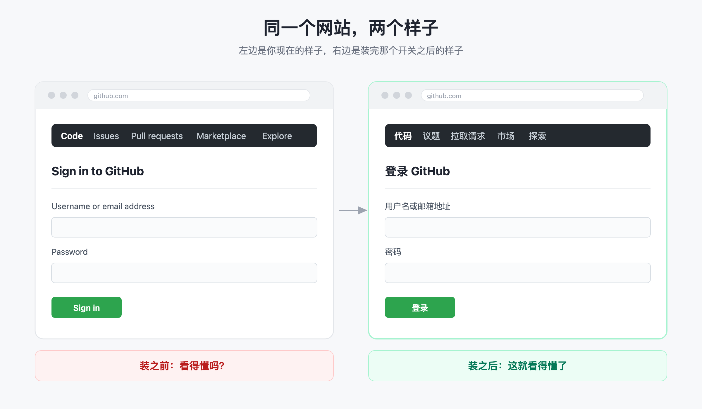

# github-chinese-setup

**GitHub 全是英文看不懂？三步把它变成中文。**

> 前两步五分钟。第三步是一个**默认关着的开关**——90% 的教程没写它，所以你照着做完了，网页还是英文。



---

## 三步（照着点就行）

| # | 做什么 | 你会看到什么 |
|---|---|---|
| 1 | 装脚本管理器「篡改猴」（Tampermonkey） | 浏览器右上角出现一个灰色小图标 |
| 2 | 装中文包：GreasyFork 上的 GitHub 汉化脚本 | 页面弹出安装确认页，点「安装」 |
| 3 | **打开那个开关**：扩展详情页 → 「允许用户脚本」 | 从灰变蓝；刷新 GitHub，界面就是中文 |

第 3 步只在 **Chrome 138 及以上**存在，按扩展单独设置，而且**开发者模式不能替代它**。开关不开，前两步白做——脚本加载了，但什么都不干，也不报错。

> 不想自己对着找？把这个仓库丢给你的 AI 助手（WorkBuddy / Claude Code / Codex / Cursor 都行），说一句「帮我把 GitHub 变成中文」，它会把每一步带着截图位置讲给你。

## 装完了还是英文？按这个顺序查（别重装）

一次排查，一条命令：

```bash
python3 scripts/diagnose.py
```

它一次打印四件事：**扩展装了没 → 那道新开关开了没 → 脚本注入范围对不对 → 你的脚本是不是还在**。macOS / Windows / Linux 都能跑。

手动查的顺序和对应病因：

| 症状 | 真正的原因 |
|---|---|
| 扩展列表里找不到篡改猴 | 第 1 步没装成功，或装到了另一个浏览器配置文件 |
| 扩展显示「已启用」，但脚本不跑 | **第 3 步的开关关着**（最常见，占九成） |
| 开关也开了，仍然没反应 | 脚本被清空过：存储里已经没有它了 |
| 换了个网站就失效 | 脚本的生效范围（`@match`）不包含这个站 |

## ⚠️ 千万别做的两件事

1. **别手改 Chrome 的配置文件去强行打开那个开关。** 那是一个带防篡改校验的判定记录，改了会触发校验失败：**扩展被禁用，而且已装的所有脚本被清空。** 我就是这么丢掉全部脚本的。
2. **别反复重装。** 「装了没反应」九成不是安装问题，是第 3 步的开关。重装一百遍也不会好。

完整排障长文（三道闸、决策树、四条死路）：[docs/why-userscript-not-working.md](docs/why-userscript-not-working.md)

## 装好之后，顺手还能用的（同一套环境，不用再装第二遍）

| 还能干什么 | 效果 |
|---|---|
| 汉化其他英文网站 | 换个中文包，别的英文站也能变中文 |
| 去广告 / 界面清爽 | 屏蔽站点广告与遮挡层，还原阅读体验 |
| 网页增强 / 改界面 | 暗色主题、加下载按钮、回滚旧版界面 |
| 更多配方 | 见 [references/recipes.md](references/recipes.md) |

**入口是「让 GitHub 变中文」，出口是「你的浏览器从此听你的」。**

## 安全：带安检门的装机员，不是百宝箱

脚本能读写你访问的每一个网页，所以每一份配方在安装前都会被打分：*它做什么* × *来源可不可信*。

- 🟢 **绿** — 只改变你自己看到的东西。直接装。
- 🟡 **黄** — 违反站点条款（跳广告、离线下载）。说清风险，你自己决定。
- 🔴 **红** — 盗取凭据、劫持剪贴板/支付地址、绕过付费墙牟利、传播版权内容。**一律拒装，无论怎么说。**

## 给 AI 助手安装（Agent Skill 形态）

纯 Markdown + 跨平台脚本，不依赖任何运行时：

```bash
git clone https://github.com/<you>/github-chinese-setup.git \
  ~/.workbuddy/skills/chrome-userscript-setup     # 或 ~/.claude/skills/、~/.codex/skills/
```

装好后不用再点名——当你抱怨「脚本装了没反应」时，助手会自己接管。

| 宿主 | 放哪里 |
|---|---|
| WorkBuddy | `~/.workbuddy/skills/` |
| Claude Code | `~/.claude/skills/` |
| Codex | `~/.codex/skills/` |
| CodeBuddy | 用 `AGENTS.md` |
| Cursor / Cline | `.cursor/rules/` 或 `.clinerules/` |
| 没有 agent | 直接打开 `docs/chrome-userscript-guide.html` |

## 仓库里有什么

| 文件 | 用途 |
|---|---|
| `SKILL.md` | Agent 入口，整个仓库就是一份 skill |
| `AGENTS.md` / `GEMINI.md` | 同样内容，给 Codex / Gemini CLI / Cursor / Cline |
| `references/recipes.md` | 绿 / 黄 / 红配方清单 + 来源审查标准 |
| `references/gotchas.md` | 10 条实战踩坑（含最贵的那个） |
| `scripts/diagnose.py` | 一条命令出状态，三平台通用 |
| `scripts/setup-macos.sh` | 半自动部署，并把人工步骤打印出来 |
| `docs/why-userscript-not-working.md` | 排障长文：三道闸 + 决策树 |
| `docs/chrome-userscript-guide.html` | 自包含图文手册，给没有 agent 的机器 |

---

## English

**Make GitHub (and other English sites) Chinese in three steps.** An Agent Skill — plain Markdown plus cross-platform scripts — that deploys Tampermonkey, handles the Chrome 138+ "Allow user scripts" gate, and diagnoses the frustrating case where everything looks installed and nothing happens.

The trap this exists to close: Chrome's `Secure Preferences` is a *verdict record*, not a config file. Edit it to force the gate open and the HMAC check fails — your value is wiped, the extension is disabled, and **every userscript you had is gone.** Full write-up: [docs/why-userscript-not-working.md](docs/why-userscript-not-working.md).

```bash
python3 scripts/diagnose.py           # extension state · the userscript gate · injection scope · storage
bash scripts/setup-macos.sh --check   # dry run, changes nothing
```

Three clicks cannot be automated, deliberately: a userscript can read and write every page you visit, so the browser requires *you* to authorize it. This skill automates everything around them and prints the rest as exact instructions.

**Risk grading** — 🟢 changes only what you see · 🟡 violates a site's ToS, one sentence of risk then your call · 🔴 credential theft, clipboard hijacking, paywall circumvention, redistributing copyrighted content — refused regardless of framing.

## License

MIT — see [LICENSE](LICENSE). 汉化脚本本身来自 [maboloshi/github-chinese](https://github.com/maboloshi/github-chinese)（GPL-3.0），本仓库只做部署与排障，不打包其代码。
