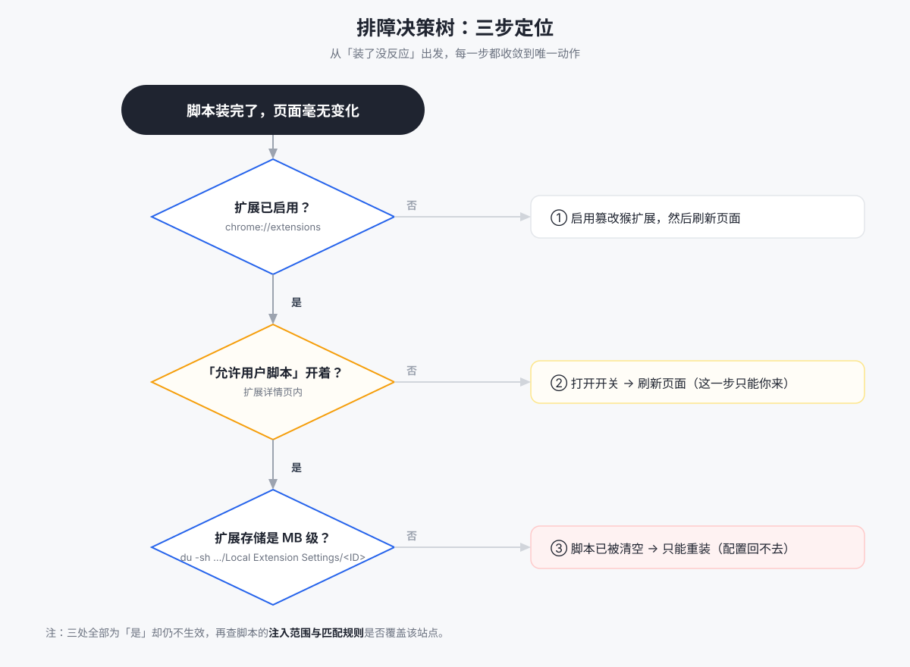
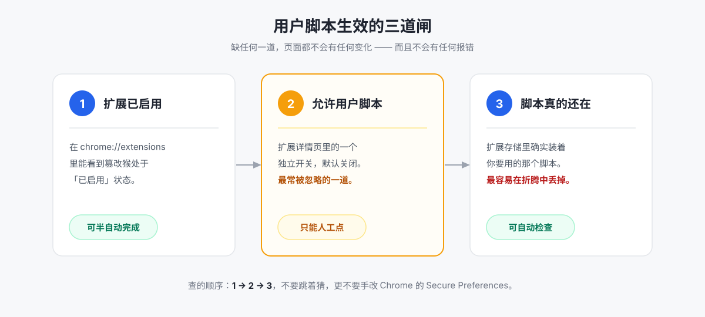

# 装了油猴脚本，页面还是英文？一次 Chrome 用户脚本失效的完整排障记录

> 前言：这不是一篇「怎么装篡改猴」的教程——那种文章到处都是。
> 这篇解决的是**装完之后没反应**的那一类问题。它的难点不在操作，在于 Chrome 有三道闸，任何一道没打开，前面的努力看起来都「没生效」，而且界面不会给你任何报错。

---

## 一、先看症状，对号入座

如果你遇到的是下面任意一条，这篇适用：

- 篡改猴装好了，脚本也从 GreasyFork 装了，**页面刷新后毫无变化**；
- Chrome 扩展页里 **篡改猴显示「已启用」**，但脚本就是不跑；
- 你试过手动改 Chrome 的配置文件去「强制开启」，结果 **扩展被禁用，之前装的脚本全没了**；
- 你重启了 Chrome、重装了扩展、重装了脚本，**全都无效**。

第三条是我亲身踩过的坑，也是最贵的一课。下面按「从便宜到贵」的顺序讲。

---

## 二、一条命令，先别猜

排障最大的浪费是「猜」。脚本不生效的可能原因有六七个，逐个试要一小时。先把状态打出来：

```bash
python3 scripts/diagnose.py
```

它会一次性告诉你四件事：

| 检查项 | 它在回答什么 |
|---|---|
| 篡改猴扩展状态 | 装了吗？启用了吗？ |
| **「允许用户脚本」开关** | 那道 138+ 新增的闸，开了没？ |
| 脚本注入范围 | 这个站点在生效名单里吗？ |
| **扩展存储体积** | （关键）脚本本体**还在不在**？ |

最后一项是很多人想不到的。**扩展启用了、开关也开了，屋里却可能一个人都没有**——脚本已经被清空了。下一节解释为什么。

整个排查可以收敛成一棵决策树，每一步都指向唯一动作：



脚本要生效，Chrome 面前实际横着三道闸：



---

## 三、Chrome 有三道闸，缺一道全白干

用户脚本要跑起来，必须同时满足三个条件。它们的「谁负责」完全不同：

| # | 闸 | 谁打开 | 说明 |
|---|---|---|---|
| 1 | 篡改猴扩展**已启用** | 可半自动 | 常规扩展开关 |
| 2 | 扩展详情页里的**「允许用户脚本」** | **只能人工点** | Chrome 138+ 新增，第二道独立的闸 |
| 3 | 你要的脚本**确实装载在扩展里** | 可自动 | 最容易在折腾中悄悄丢失 |

**闸 2 是最容易被忽略的**。绝大多数老教程写于 Chrome 138 之前，所以只提「装扩展、开开发者模式」。而现在：

> 扩展启用 ≠ 脚本能跑。
> 开发者模式**不再**能替代「允许用户脚本」这个开关。
> 也没有任何企业策略能替你把它打开——浏览器是**故意**这么设计的。

设计原因不难理解：用户脚本能读写你访问的每一个页面，权限等同「接管浏览器」。所以浏览器要求**你本人**知情并授权，任何自动化手段都不该绕过它。

---

## 四、三种典型失效，逐个拆

### 模式一：装了一半

**症状**：扩展装了，脚本没装（或装到了另一个浏览器 profile 里）。

**判定**：看扩展的脚本列表，是不是 0 个。

**修法**：装脚本本身很简单，难的是选脚本。别在 GreasyFork 上按下载量盲选——先看源码，再决定装不装（见第六节的分级）。

---

### 模式二：都装了，闸没开

**症状**：扩展启用中，脚本列表里也有，但页面纹丝不动，**控制台没有报错**。

**判定**：

1. 打开 `chrome://extensions`；
2. 找到篡改猴 → 点「详情」；
3. 找到 **「允许用户脚本」（Allow user scripts）** 开关。

这个开关**默认是关的**，就藏在这一层里。打开，然后**刷新页面**。

**注意**：Chrome 在 138 那次升级时做过一次迁移——如果你当时**已经开着**开发者模式，它会为**那一刻已安装的扩展**自动打开这个开关。**迁移之后新装的扩展没有这个待遇**。所以「我开发者模式一直开着」完全不构成理由，直接去看那个开关的实际状态。

---

### 模式三：都开了，脚本没了（最贵的一课）

**症状**：配置全绿——扩展启用、开关打开，但页面依然没变化。

**原因**：脚本被清空了。

**故事**：我为了让脚本生效，试着**直接编辑 Chrome 的 `Secure Preferences` 文件**，往篡改猴的条目里加 `user_scripts_enabled: true`。结果：

1. Chrome 的 HMAC 防篡改校验发现文件被外部修改；
2. 你写入的值被判定无效并**丢弃**；
3. 扩展被**禁用**；
4. 更严重的：扩展的 `Local Extension Settings` 被当成「全新安装」**重置清空**——**里面所有用户脚本一起没了**。

关键认知：

> **`Secure Preferences` 是「判定结果的记录」，不是「配置入口」。**
> 它受 HMAC 校验保护，写它等于自首。

**判定脚本是否还在**：

```bash
# macOS 路径，扩展 ID 换成你的
du -sh ~/Library/Application\ Support/Google/Chrome/Default/Local\ Extension\ Settings/<扩展ID>
```

正常应该是 **MB 级**（脚本本体存在这里）；缩到 **几 KB** 就是空的。

**修法**：配置能回滚，**脚本回不去**——只能重装。装完**务必看页面验收**，别只看配置项全绿。

---

## 五、这四条路我都试过了，别再走

排障时最容易浪费在一堆「看起来可行的自动化」上。以下是我实际验证失败的，列出来帮你省掉这一小时：

| 尝试 | 结果 |
|---|---|
| 写 `Secure Preferences` 开那个开关 | HMAC 校验失败 → 扩展被禁 + 脚本被清空 |
| 用 CDP（`--remote-debugging-port`）接管默认 profile 自动点击 | Chrome 136+ 已禁用该路径 |
| AppleScript 模拟点击 / 键盘输入操作 `chrome://` 页面 | 被系统隐私权限挡死（error -10004） |
| `open` 命令打开 `chrome://` 或 `chrome-extension://` 地址 | 静默失败，什么都不会发生 |

**结论**：涉及浏览器安全边界的操作，「半自动 = 把地址和按钮位置用文字告诉用户」才是正解，硬刚自动化只会亏时间。

---

## 六、选脚本：先看它要什么权限

排障的另一半是「装完之后该不该让它跑」。用户脚本的权限等于「读取并改写你访问的所有页面」，所以装之前值得花十秒做一次判断。我自己的标准是**两个维度**：

| | 来源可信（知名作者 / 有源码仓库 / Star 多） | 来源不明（匿名 / 混淆代码 / 只看得到压缩产物） |
|---|---|---|
| **功能无害**（只改配色、汉化界面、加键盘快捷键） | 🟢 直接装 | 🟡 谨慎 |
| **打擦边**（跳广告、离线下载、解锁付费墙 UI） | 🟡 提示风险后自决 | 🔴 不装 |
| **明确有害**（偷 Cookie / 劫持剪贴板 / 重定向支付） | 🔴 不装 | 🔴 不装 |

关键是**二维**，不是一维：一个功能上完全无害的脚本，如果来源是个混淆过的匿名上传，同样不该装。

---

## 七、版本对照：你该点几下

| Chrome 版本 | 人工点击步数 |
|---|---|
| ≤ 137 | 1 步：启用扩展 |
| **≥ 138** | **2 步：启用扩展 + 打开「允许用户脚本」** |

这两步**没有任何自动化能替代**。所有工具能做到的，是把它们**之外**的事情自动化掉，并且把这两步精确地打印成「点哪个按钮、你会看到什么、什么样算完成」。

---

## 八、把上面的流程打包成一个工具

我把这套流程做成了一个可复用的 skill / 命令集：

- `scripts/diagnose.py`：一条命令输出上面那张状态表，跨 macOS / Windows / Linux；
- `scripts/setup-macos.sh --check`：只看不改的半自动部署；
- 完整踩坑清单与配方：`references/gotchas.md`、`references/recipes.md`；
- 不装任何工具也能用：`docs/chrome-userscript-guide.html` 是自包含的图文手册。

它同时适用于 **WorkBuddy / Claude Code / Codex / Cursor / Gemini CLI** 等能读 Markdown 的 agent；不带 agent 的机器上，那份 HTML 手册也能一路走完。

代码与文档：`github.com/<your-name>/chrome-userscript-setup`

---

## 一句话总结

装完没反应，99% 是三道闸里有一道没开——**扩展启用**、**允许用户脚本**、**脚本真的还在**。
按这个顺序查，不要猜，更不要手改 Chrome 的 `Secure Preferences`。
